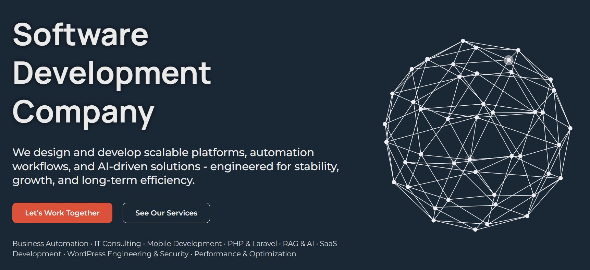

# GLOBUS.studio

  

  
  
  
  
  
  
  

  
  
  
  
  

  
  
  
  
  
  
  
  
  
  
  
  

We build digital products your team will still want to extend a year from now — platforms, SaaS, automation, AI.

No juniors. No outsourcing chains. Direct communication, predictable timelines, and code that can actually be extended a year from now.

[Website](https://globus.studio) · [Blog](https://globus.studio/globus-studio-insights-updates-it-news/) · [Contact](https://globus.studio/contact-us-to-develop-agency-solutions/)

---

## Services

### Core

- **WordPress Development** — custom plugins, themes, WooCommerce, security, performance. Deep internals: WP-Cron, REST API, WP-CLI, multisite, Gutenberg.
- **PHP & Laravel** — SaaS backends, APIs, microservices, business logic. PHP 7.4–8.5, Laravel 10–12. High-load, queues, caching layers.
- **AI & RAG Integration** — NLP, RAG pipelines, chatbots, generative AI. Vector databases, embeddings, LLM orchestration.

### Also skilled in

- **Business Automation (n8n)** — workflow automation, custom nodes, service integrations
- **Mobile Apps (Flutter)** — cross-platform Android and iOS development
- **IT Consulting** — architecture audits, technology strategy, solutions design
- **SEO & Digital Advertising** — search visibility and growth-driven marketing

---

## Products

| Product | Description | Status |
|---|---|---|
| [**BotBlocker**](https://botblocker.top) | WordPress firewall & bot defense. 3-layer interception, 9 CAPTCHA modes, 2FA, GeoIP, FCrDNS, cloud threat intelligence. | 3,000+ installs · 5/5 ★ |
| [**GS.API**](https://app.globus.studio) | Developer APIs — geolocation, validation, utilities. No quotas, no restrictions. | Live |
| [**Atomic Framework**](https://atomic.globus.studio) | Compact PHP framework for rapid development. Zero bloat, sub-millisecond overhead. | Live |

---

## Open Source

We maintain 12+ public repositories.

| Repository | Stars |
|---|---|
| [SypexGeoRS](https://github.com/GLOBUS-studio/SypexGeoRS) — Fast pure-Rust reader for SypexGeo IP geolocation databases | ★ 56 |
| [WP-Update-Manager](https://github.com/GLOBUS-studio/WP-Update-Manager) — Disable All WordPress Updates with Full Control | ★ 36 |
| [PhpObfuscator](https://github.com/GLOBUS-studio/PhpObfuscator) — Token-based PHP source-code obfuscator | ★ 24 |
| [GStime](https://github.com/GLOBUS-studio/GStime-JavaScript-Library) — Lightweight jQuery-compatible DOM manipulation library | ★ 22 |
| [CSSMinifier](https://github.com/GLOBUS-studio/CSSMinifier) — Compact PHP CSS minification tool | ★ 22 |
| [PHP-Async](https://github.com/GLOBUS-studio/PHP-Async) — Async PHP with fibers | ★ 22 |
| [Cortex-Atomic](https://github.com/GLOBUS-studio/Cortex-Atomic) — Multi-engine ORM/ODM for Fat-Free & Atomic Framework | ★ 22 |
| [SmartIP-Detector](https://github.com/GLOBUS-studio/SmartIP-Detector) — Robust client IP detection for any environment | ★ 21 |
| [SypexGeo](https://github.com/GLOBUS-studio/SypexGeo) — Pure-PHP reader for SypexGeo binary IP geolocation databases | ★ 21 |
| [SimpleServerStat](https://github.com/GLOBUS-studio/SimpleServerStat) — Lightweight server dashboard — CPU & RAM monitoring | ★ 20 |
| [PHP-UnCSS](https://github.com/GLOBUS-studio/PHP-UnCSS) — Remove unused styles from CSS | ★ 22 |

[View all repositories →](https://github.com/orgs/GLOBUS-studio/repositories)

---

## Projects by the founder

Open-source tools & AI skills by [Yevhen Leonidov](https://github.com/MADEVAL).

### PHP

| Repository | Stars |
|---|---|
| [FerryAI](https://github.com/MADEVAL/FerryAI) — Native AI inference: ONNX, GGUF, RubixML via PHP FFI | ★ 56 |
| [phpQRcode](https://github.com/MADEVAL/phpQRcode) — Zero-dependency QR Code generator, PHP 7.4–9.0 | ★ 45 |
| [ReadSight](https://github.com/MADEVAL/ReadSight) — Multilingual readability, 86 languages, 17 formulas | ★ 42 |
| [ATOM](https://github.com/MADEVAL/ATOM) — PHP 8.5 micro-framework: router, DI, validation, templates | ★ 35 |
| [Fingerprint-PHP](https://github.com/MADEVAL/Fingerprint-PHP) — Browser fingerprinting library for PHP | ★ 35 |
| [Atomic-Framework](https://github.com/MADEVAL/Atomic-Framework) — Lightweight PHP framework based on Fat-Free | ★ 33 |
| [Atomic-Framework-Application](https://github.com/MADEVAL/Atomic-Framework-Application) — Application template for Atomic Framework | ★ 31 |
| [BotBlocker-Add-on-Developer-Kit](https://github.com/MADEVAL/BotBlocker-Add-on-Developer-Kit) — SDK for BotBlocker add-ons | ★ 8 |

### JavaScript

| Repository | Stars |
|---|---|
| [Oat-Upload](https://github.com/MADEVAL/Oat-Upload) — Lightweight upload component for Oat UI | ★ 47 |
| [Oat-Table](https://github.com/MADEVAL/Oat-Table) — Sortable, filterable table for Oat UI | ★ 45 |
| [Fingerprint-JS](https://github.com/MADEVAL/Fingerprint-JS) — Browser fingerprinting library | ★ 43 |
| [WP-robots-generator](https://github.com/MADEVAL/WP-robots-generator) — Client-side robots.txt generator, zero dependencies | ★ 32 |

### AI / LLM Skills

| Repository | Stars |
|---|---|
| [HumanAI](https://github.com/MADEVAL/HumanAI) — Rewrite AI text to human, 9 languages, 5-stage pipeline | ★ 54 |
| [MindFluence](https://github.com/MADEVAL/MindFluence) — 20 cognitive biases → marketing copy | ★ 52 |
| [Pre-Mortem-Skill](https://github.com/MADEVAL/Pre-Mortem-Skill) — Find failure causes before you launch | ★ 52 |
| [AngleCraft](https://github.com/MADEVAL/AngleCraft) — 7+2 journalistic angle types for AI content | ★ 47 |
| [RankWise](https://github.com/MADEVAL/RankWise) — SEO Content Engine, 49 ranking factors | ★ 46 |
| [Atomic-Framework-Skills](https://github.com/MADEVAL/Atomic-Framework-Skills) — AI skill for Atomic Framework | ★ 10 |

### Python

| Repository | Stars |
|---|---|
| [ReadSightPy](https://github.com/MADEVAL/ReadSightPy) — Readability for Python, 86 languages, 17 formulas | ★ 44 |

[View all →](https://github.com/MADEVAL?tab=repositories)

---

## Tech stack

| Category | Tools |
|---|---|
| **Languages** | PHP, Rust, JavaScript, Python, Dart |
| **Frameworks** | Laravel, Fat-Free, Atomic, Flutter, Vue.js |
| **Databases** | MySQL, PostgreSQL, Redis, Memcached, SQLite |
| **Infrastructure** | Linux, Docker, Nginx, Apache, Cloudflare |
| **Tooling** | Git, GitHub Actions, n8n, WP-CLI, Composer, npm, Cargo |

---

## How we work

1. **Analysis & Planning** — we study your business objectives and define the technical direction.
2. **System Design** — scalable architecture, data models, integrations, infrastructure.
3. **Development** — iterative delivery with CI/CD from day one, code review on every commit, transparent process.
4. **Launch & Support** — deployment, monitoring, optimization, long-term partnership.

Typical engagement: 2-week sprint cycles · direct access to the developer building your product · Slack/Telegram async communication.

---

## Let's work together

  <a href="https://globus.studio/contact-us-to-develop-agency-solutions/"><strong>→ Start a project</strong></a>
  &nbsp;&nbsp;·&nbsp;&nbsp;
  <a href="mailto:sales@globus.studio">✉ sales@globus.studio</a>
  &nbsp;&nbsp;·&nbsp;&nbsp;
  <a href="tel:+972559662184">📞 +972 (55) 966-21-84</a>

---

## Links

- Founder: [https://github.com/MADEVAL](https://github.com/MADEVAL)
- BotBlocker: [https://github.com/BotBlocker-Security](https://github.com/BotBlocker-Security)
- Website: [https://globus.studio](https://globus.studio)
- Telegram: [https://t.me/GLOBUSstudio](https://t.me/GLOBUSstudio)
- LinkedIn: [https://www.linkedin.com/company/globus-studio](https://www.linkedin.com/company/globus-studio)
- YouTube: [https://www.youtube.com/@GLOBUS.studio_channel](https://www.youtube.com/@GLOBUS.studio_channel)
- Blog: [https://globus.studio/globus-studio-insights-updates-it-news/](https://globus.studio/globus-studio-insights-updates-it-news/)

---

*© 2020–2026 GLOBUS.studio. All rights reserved.*
